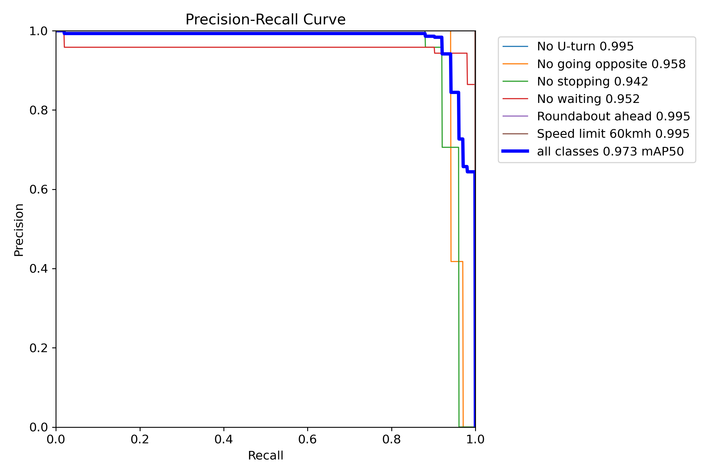
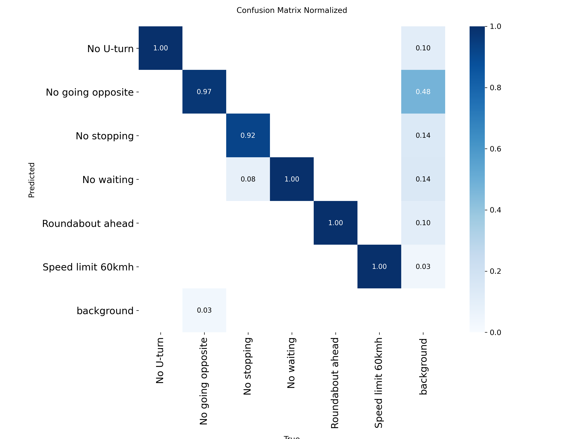
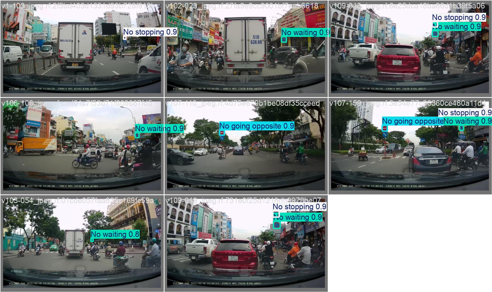
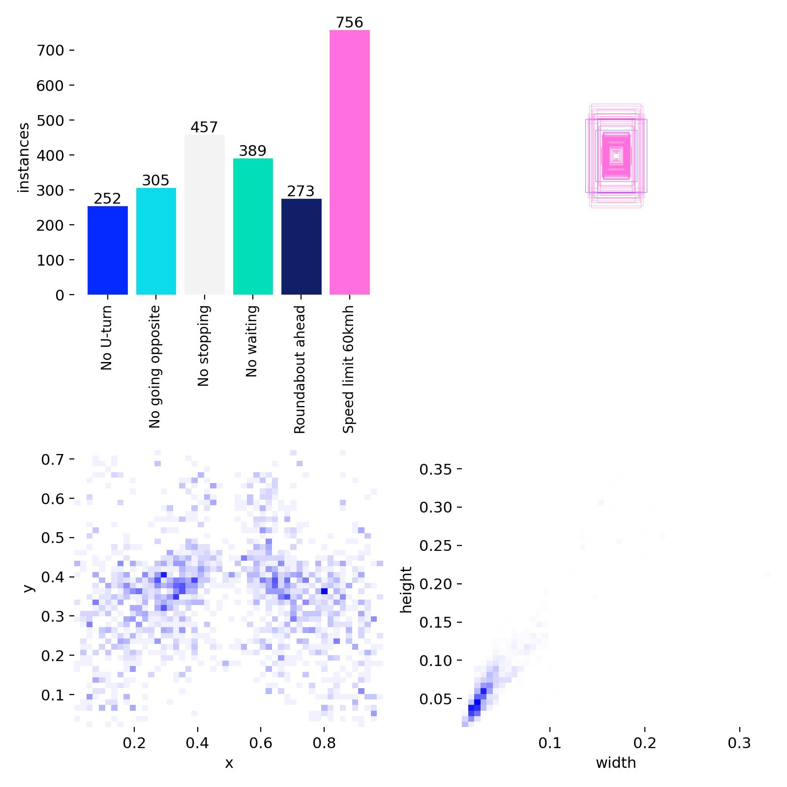
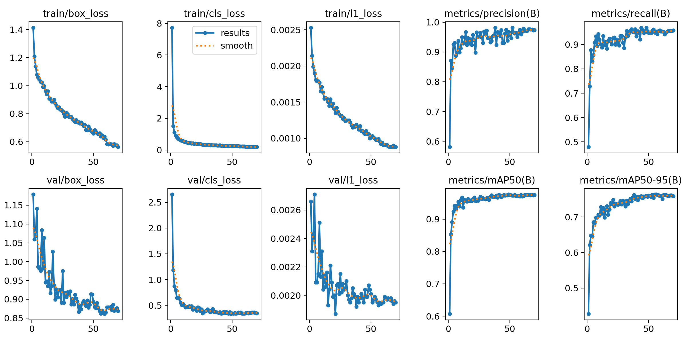

# VN-traffic-sign-detection

Fine-tuning a **YOLO26n** object detector to detect **Vietnamese traffic signs**, with a focus on
data quality (class-balance analysis, perceptual-hash deduplication, targeted augmentation) to
improve generalization on a small, imbalanced dataset.

The full workflow lives in [`vietnam-traffic-sign-with-yolo26n.ipynb`](./vietnam-traffic-sign-with-yolo26n.ipynb)
(dataset preparation -> training -> evaluation -> inference), and the saved Ultralytics run
artifacts are in [`output/working/runs/detect`](./output/working/runs/detect). A static HTML summary
of the run is available at [`index.html`](./index.html).

---

## Results

Held-out **test** evaluation with the best checkpoint (`split="test"`, `imgsz=832`):

| Metric | Test result |
| --- | --- |
| mAP@0.50 | **0.9727** |
| mAP@0.50:0.95 | **0.7836** |
| Mean precision | 0.9686 |
| Mean recall | 0.9633 |

Per-class AP@0.50 (from the test precision-recall plot):

| Class | AP@0.50 |
| --- | --- |
| No U-turn | 0.995 |
| No going opposite | 0.958 |
| No stopping | 0.942 |
| No waiting | 0.952 |
| Roundabout ahead | 0.995 |
| Speed limit 60kmh | 0.995 |

Best validation `mAP@0.50:0.95` during training was **0.7635** at epoch 56
(val precision 0.9502, recall 0.9543, mAP@0.50 0.9711). Validation metrics are used for model
selection; the numbers above are the separate explicit test-split evaluation.

<p align="center">
  
  
</p>
<p align="center">
  
</p>

---

## Dataset

Source: Roboflow **Vietnamese-Traffic-Signs-Detection** (v7), YOLO format, **6 classes**:
`No U-turn`, `No going opposite`, `No stopping`, `No waiting`, `Roundabout ahead`,
`Speed limit 60kmh`.

| Split | Images before preprocessing | Use |
| --- | --- | --- |
| Train | 2,118 | Deduplication + augmentation, then fitting |
| Validation | 196 | Training-time model selection and validation metrics |
| Test | 103 | Final held-out evaluation |

The dataset's official train/valid/test folders are used as-is. Although a 10% train-to-validation
split is described in the commented-out code, the active code keeps the original splits to avoid
test leakage.

### Class imbalance and duplicate filtering

Before filtering, the training labels contained **2,730** object instances. Classes with more than
`HEAVY_THRESH = 400` instances are treated as *heavy*; the speed-limit class (`189`) is the only
*rare* class below `RARE_THRESH = 200`.

| Class | Instances before dedup | Instances after dedup |
| --- | --- | --- |
| No U-turn | 252 | 252 |
| No going opposite | 573 | 215 |
| No stopping | 504 | 225 |
| No waiting | 939 | 353 |
| Roundabout ahead | 273 | 273 |
| Speed limit 60kmh | 189 | 189 |
| **Total** | **2,730** | **1,507** |

- **pHash deduplication** (Hamming distance `PHASH_THRESH = 5`) is applied only to the 1,404
  training images whose labels contain heavy classes. It removed 902 near-duplicate images, leaving
  1,216 training images before augmentation.
- **Targeted augmentation** uses an Albumentations bbox-safe pipeline (`format="yolo"`, `clip=True`,
  `min_visibility=0.3`):
  - *Light* pass on every retained image: horizontal flip (`p=0.5`).
  - *Strong* passes (`RARE_AUG_PASSES = 3`) on images containing the rare speed-limit class:
    horizontal flip, rotation up to 12°, brightness/contrast, Gaussian blur, and shift/scale.
- Validation and test images are **not** augmented. No fixed-size resize is applied at
  preprocessing (`IMG_SIZE = None`); training uses `imgsz=832`.

The prepared dataset is written to `dataset_yolo/` with a generated `data.yaml`.



---

## Model training

A pretrained **YOLO26n** detector (`yolo26n.pt`) is fine-tuned with Ultralytics.

| Setting | Value |
| --- | --- |
| Image size | 832 |
| Epochs / batch size | 70 / 12 |
| Optimizer | AdamW |
| Initial learning rate | 0.001 |
| Early-stopping patience | 15 epochs |
| Mosaic | 0.3, disabled for the final 10 epochs (`close_mosaic=10`) |
| Execution | GPU 0, 2 workers, image cache enabled, AMP enabled |
| Reproducibility | Seed 0, deterministic mode |

The run completed all 70 epochs in about **1,844 s (~30.7 min)**. Training/validation losses
declined while precision, recall and mAP rose and then plateaued.



---

## Evaluation and inference

Evaluation loads `runs/detect/train/weights/best.pt` and runs `model.val(..., split="test")` at
`imgsz=832`, `batch=8`, with plots enabled. A `run_inference(image_path, conf=0.25)` helper is
included in the notebook for qualitative inspection of single images.

---

## Repository structure

```
.
├── vietnam-traffic-sign-with-yolo26n.ipynb   # End-to-end notebook (data prep -> train -> eval -> inference)
├── index.html                                # Static HTML report of the run
├── assets/                                   # Report figures (curves, confusion matrix, predictions)
│   ├── test_confusion_matrix.png
│   ├── test_precision_recall.png
│   ├── test_predictions.jpg
│   ├── training_curves.png
│   └── training_label_distribution.jpg
├── output/working/runs/detect/               # Saved Ultralytics run artifacts
│   ├── train/                                # Training results, curves, batches, weights (best.pt, last.pt)
│   └── val/                                  # Validation plots and prediction batches
├── .gitignore
└── LICENSE
```

Each run directory contains the standard Ultralytics outputs: `results.csv` / `results.png`,
`Box{P,R,F1}_curve.png`, `BoxPR_curve.png`, confusion matrices, batch visualizations, and (for the
training run) `weights/best.pt` and `weights/last.pt`.

---

## How to reproduce

1. Install dependencies (CPU or GPU environment):

   ```bash
   pip install -U ultralytics albumentations imagehash roboflow
   ```

2. Open `vietnam-traffic-sign-with-yolo26n.ipynb` and run the cells in order. The notebook was
   developed on Kaggle and writes to `/kaggle/working/...`; update the `SRC`, `DST` and
   `save_dir`/`best.pt` paths for your environment.
3. Training and evaluation use `dataset_yolo/dataset.yaml` (auto-generated by the notebook).

---

## Notes and limitations

- The reported metrics come from a single small held-out test split (103 images), so treat them as
  indicative rather than a claim of road-safety readiness. Evaluate on additional routes, cameras,
  lighting and weather before any deployment.
- Performance is strongest for *No U-turn*, *Roundabout ahead* and *Speed limit 60kmh*; *No
  stopping* and *No waiting* have the lowest per-class AP and merit review (small/occluded/
  overlapping signs, label consistency).
- The pHash dedup pass only compares selected training images, so it does not prove near-duplicates
  are absent from the validation/test splits. A cross-split duplicate audit is recommended.
- Among background false positives the most frequent prediction is *No going opposite*; consider
  adding representative hard-negative scenes.
- **Security:** the notebook currently hard-codes a Roboflow API key. Before publishing or sharing,
  rotate that key and load it from an environment variable / secret instead of committing it.

---

## License

See [LICENSE](./LICENSE).